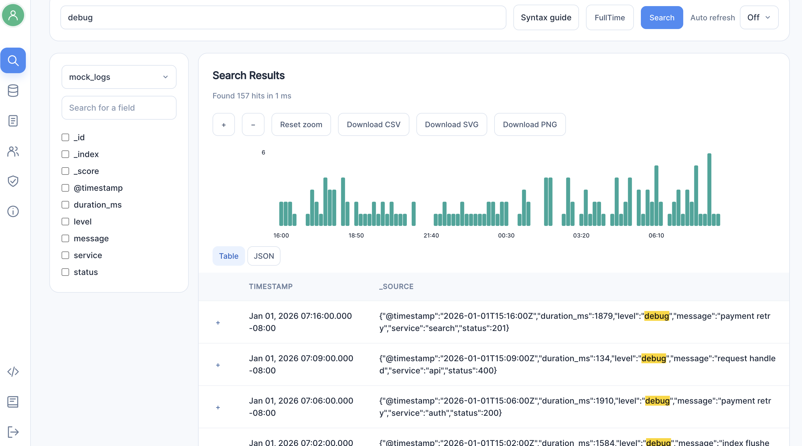
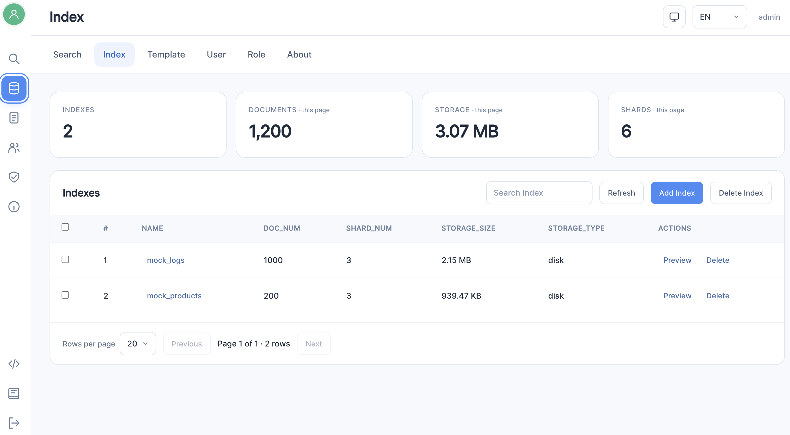

<p align="center">
  
</p>

[](https://github.com/vcaesar/zedsearch/actions/workflows/ci.yml)
[](https://github.com/vcaesar/zedsearch/actions/workflows/nightly.yml)
[](https://github.com/vcaesar/zedsearch/actions/workflows/release.yml)
[](https://pkg.go.dev/github.com/vcaesar/zedsearch)
[](../go.mod)
[](https://golangci-lint.run/)
[](https://github.com/vcaesar/zedsearch/releases/latest)
[](https://zincsearch-docs.zinc.dev/) [](https://codecov.io/github/vcaesar/zedsearch)

[English](../README.md) | [简体中文](README.zh.md) | [繁體中文](README.zht.md) | [日本語](README.ja.md) | 한국어 | [Français](README.fr.md) | [Deutsch](README.de.md) | [Español](README.es.md) | [Русский](README.ru.md) | [Português](README.pt.md)

# ZedSearch

ZedSearch는 전문(full text) 색인을 수행하는 검색 엔진입니다. Elasticsearch의 경량 대안으로, 아주 적은 리소스로 실행됩니다. 기본 색인 라이브러리로 [bluge](https://github.com/blugelabs/bluge)([vcaesar/riot](https://github.com/vcaesar/riot) 포크를 통해)를 사용합니다.

이해하고 조정해야 할 수십 개의 설정이 필요한 Elasticsearch와 달리 매우 간단하고 운영하기 쉽습니다. ZedSearch는 2분 안에 설치하고 실행할 수 있습니다.

API로 데이터를 수집하고 Kibana로 검색하기만 한다면 Elasticsearch를 그대로 대체할 수 있습니다(ZedSearch는 Kibana를 지원하지 않습니다. ZedSearch는 자체 UI를 제공합니다).

ZedSearch의 간단한 데모는 아래 동영상을 확인하세요.

[](https://www.youtube.com/watch?v=aZXtuVjt1ow)

# 왜 ZedSearch인가

Elasticsearch는 매우 좋은 제품이지만 복잡하고 많은 리소스가 필요하며 10년도 더 된 제품입니다. 저는 사람들이 많은 작업 없이도 전문 검색 색인을 더 쉽게 사용할 수 있도록 ZedSearch를 만들었습니다.

# 기능:

go + gin + react

1. 전문 색인 기능 제공
2. 설치와 실행을 위한 단일 바이너리. 여러 플랫폼용 바이너리를 Releases에서 제공합니다.
3. React로 작성된 데이터 조회용 Web UI(바이너리에 내장)
4. 데이터 수집을 위한 Elasticsearch API 호환성(단일 레코드 및 벌크 API)
5. 기본 제공 인증
6. 스키마리스 - 스키마를 미리 정의할 필요가 없으며, 같은 인덱스 내의 서로 다른 문서가 서로 다른 필드를 가질 수 있습니다.
7. 인덱스를 디스크에 저장
8. 집계(aggregation) 지원
9. 이벤트 시간 정규화와 로그 검색 기본값을 갖춘 옵트인 [로그 인덱스](../pkg/logs/README.md)

# 문서

문서는 [https://zincsearch-docs.zinc.dev/](https://zincsearch-docs.zinc.dev/)에서 확인할 수 있습니다

# 스크린샷

## 검색 화면



## 인덱스 화면



# 시작하기

## 빠른 시작

[빠른 시작](https://zincsearch-docs.zinc.dev/quickstart/)을 확인하세요

# 릴리스

ZedSearch는 수백 개의 프로덕션 환경에 설치되어 있습니다.

## 빌드

소스 빌드는 **기본적으로 API 전용**입니다: Node.js, npm, `frontend/` 디렉터리가 필요하지 않습니다.
`ZED_FIRST_ADMIN_USER` / `ZED_FIRST_ADMIN_PASSWORD`(또는 `conf/zed.toml`)로
최초 시작 자격 증명을 설정한 다음, 저장소 루트에서 실행하세요:

```sh
go run cmd/zedsearch/main.go      # API-only, :4080
go run cmd/zedsearch/main.go web  # build and embed the console, then start
# Equivalently, from cmd/zedsearch/: go run main.go [web]
```

`web`에는 소스 체크아웃, Go, Node.js 24+, npm이 필요합니다. `npm ci`,
`npm run build`, `go build -tags web`을 실행하여 `test/zedsearch-web`
(Windows에서는 `.exe`)을 생성합니다. 결과 바이너리는 모든 UI 에셋을 내장하고 있어
프런트엔드 파일이나 Node.js가 없는 다른 호스트로 복사해 사용할 수 있습니다. 시작 시 호출자의
작업 디렉터리, 설정, 환경 변수가 유지됩니다. 이미 `-tags web`으로 빌드된 바이너리는
`web` 인수 유무와 관계없이 다시 빌드하지 않고 바로 시작합니다.

수동 빌드:

```sh
go build -o zedsearch ./cmd/zedsearch  # API-only
(cd frontend && npm ci && npm run build)
go build -tags web -o zedsearch ./cmd/zedsearch
```

API 전용 노드는 `/`에서 버전 JSON을 반환하며, `/ui/`와 Swagger UI는 비활성화됩니다.
Web 빌드는 `/`를 `/ui/`로 리디렉션하고, 설정에서 활성화된 경우 Swagger를 제공합니다.
`sh/build.sh`, 릴리스 바이너리, 표준 Docker 이미지에는 여전히 UI가 포함됩니다.

실험적인 멀티 노드 문서 저장소는 빈 `cmd/distr/` 디렉터리가 아니라 `distribution/cmd`에 있습니다.
프런트엔드 에셋은 전혀 필요하지 않습니다:

```sh
(cd distribution/cmd && go run main.go -id n1 -data ../../test/n1 -bootstrap)
```

각 노드마다 서로 다른 ID, 데이터 디렉터리, Raft 주소, gRPC 주소를 사용하세요.
클러스터 참여와 TLS는 [distribution/README.md](../distribution/README.md)를 참고하세요. 이것은
독립적인 복제 문서 저장소이며, 분산 ZedSearch REST/UI 서버가 아닙니다.

- CI(lint, Linux/macOS/Windows에서 `go test`, 커버리지): [`.github/workflows/ci.yml`](../.github/workflows/ci.yml) → https://github.com/vcaesar/zedsearch/actions/workflows/ci.yml
- Nightly 개발 이미지 `ghcr.io/vcaesar/zedsearch-dev:nightly`: [`.github/workflows/nightly.yml`](../.github/workflows/nightly.yml) → https://github.com/vcaesar/zedsearch/actions/workflows/nightly.yml
- 릴리스(`v*` 태그, goreleaser, `ghcr.io/vcaesar/zedsearch`): [`.github/workflows/release.yml`](../.github/workflows/release.yml) → https://github.com/vcaesar/zedsearch/actions/workflows/release.yml

> **참고 — Nightly / 개발 이미지(push)는 포크에서 실패합니다:**
>
> ```
> Error: buildx failed with: ERROR: failed to build: failed to solve: failed to push ghcr.io/vcaesar/zedsearch-dev:0.4.11-8792c59-dev: denied: permission_denied: The requested installation does not exist.
> ```
>
> 이 워크플로는 저장소의 `GITHUB_TOKEN`으로 GHCR에 로그인하는데, 이 토큰은 워크플로를 실행하는 저장소의
> 소유자 아래에만 패키지를 push할 수 있습니다. 포크에서는 토큰이 `vcaesar` 조직에 접근할 수 없으므로
> push가 거부됩니다. `vcaesar/zedsearch`에서 워크플로를 실행하거나, `nightly.yml`의 `env.IMAGE`를
> `ghcr.io/<your-owner>/zedsearch-dev`로 변경하세요(패키지가 저장소에 연결되어 있고 /
> 저장소에 `packages: write` 권한이 있는지 확인하세요).

# 커뮤니티

- ZedSearch 개발 및 기여 방법

  [기여 가이드](../CONTRIBUTING.md)를 확인하세요. [로드맵](https://zincsearch-docs.zinc.dev/roadmap/)도 확인하세요

# 예제

ZedSearch를 사용하여 어떤 데이터든 색인하고 검색할 수 있습니다. 다음은 사람들이 zedsearch를 사용해 Enron 이메일 데이터셋을 색인하고 검색한 예제입니다:

1. https://github.com/jorgeloaiza48/Enron-Email-DataSet
1. https://github.com/jhojanperlaza/email_search_engine
1. https://github.com/carlosarraes/zinmail
1. https://github.com/devjopa/golab-search
1. https://github.com/avaco2312/zincsearch
1. https://github.com/paolorossig/email-indexer
1. https://github.com/ulimonte05/zincsearching
